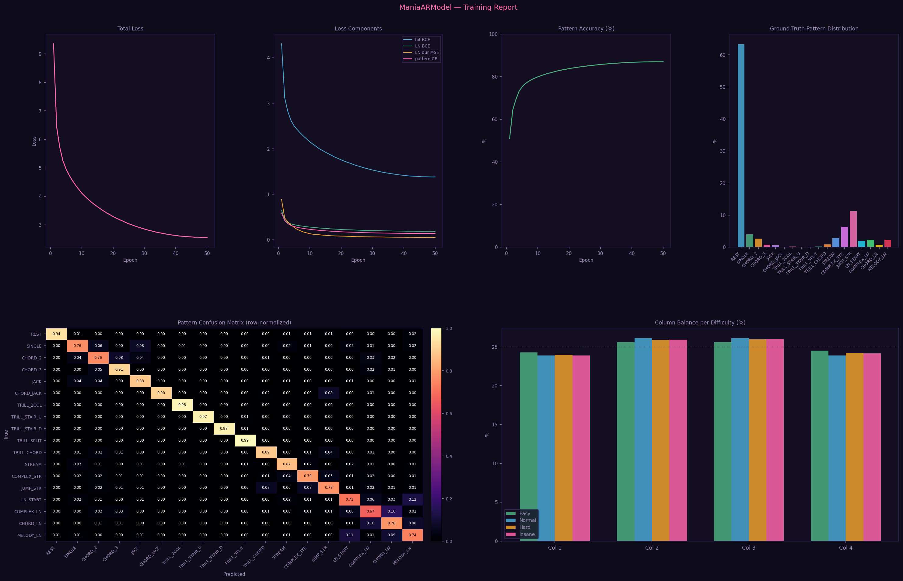

# ManiaMapper

An AI-powered osu!mania 4K beatmap generator. Feed it an audio file, get a playable `.osz` beatmap.

It uses a style-conditioned LSTM trained on real maps to place notes in a musically-aware way — responding to beats, onsets, energy, and spectral content across bass, mid, and high frequency bands.

---

## Features

- **AI note generation** via a 3-layer LSTM (256 hidden units) trained on 10 distinct mapping styles
- **Audio analysis** with Librosa: BPM detection, beat tracking, onset detection, 20-coefficient MFCC
- **4 difficulty presets**: Easy, Normal, Hard, Insane
- **Anti-pattern rules**: min-gap enforcement, same-hand ABA filtering, breathe cooldowns
- **Pattern library**: 11 trill types, chord jacks, staircases
- **Long notes** (LNs) with energy-dependent probability
- **Optional SV** (speed variation) that reacts to song energy (0.70–1.30×)
- **Rule-based fallback** with Markov chain column transitions if no model is loaded
- Outputs standard `.osz` files — double-click to import into osu!

---

## Requirements

```
pip install librosa numpy torch tqdm
```

Python 3.6+. CUDA is supported but optional (falls back to CPU).

Audio formats: MP3, OGG, WAV, FLAC.

---

## Usage

### Generate a beatmap

```bash
python ManiaMapper.py song.mp3
python ManiaMapper.py song.mp3 --output my_map.osz
python ManiaMapper.py song.mp3 --nn mania_model.pt
```

You'll be prompted for song title, artist, difficulty level, and whether to add speed variation.

**A trained model is required** — `ManiaMapper.py` looks for `mania_model.pt` next to the script (or at the path passed via `--nn`) and exits with an error if it isn't found. No trained weights are included in this repo; train your own (below).

### Train a custom model

Organize your training maps like this:

```
ManiaStyles/
├── tech/
│   ├── song_1/
│   │   ├── map.osu
│   │   └── audio.mp3
│   └── song_2/
├── streams/
├── ln/
└── ...
```

These style folders are just how training data gets organized on disk for variety — they are not fed to the model as a style label (see [Neural network architecture](#neural-network-architecture)).

```bash
python ManiaNNTrainer.py --maps-dir C:\ManiaStyles
python ManiaNNTrainer.py --maps-dir C:\ManiaStyles --epochs 20 --max-maps 3000
```

This produces `mania_model.pt` (the `--out` flag changes the path), which you pass to `ManiaMapper.py` via `--nn`.

---

## How It Works

```
Audio File
    ↓
Librosa Analysis  →  BPM, beats, onsets, MFCC, spectral bands
    ↓
Beat Grid         →  Timing subdivision aligned to detected beats
    ↓
LSTM Inference    ←  mania_nn_model.pt
    ↓
Note Assignment   →  Column selection + anti-pattern filtering
    ↓
SV Generation     →  (optional) Energy-reactive speed points
    ↓
.osu Writer       →  Standard osu!mania format
    ↓
.osz Package      →  Ready to import
```

### Neural Network Architecture

```
Input:  (B, T, 25)   — 20 MFCC + 3 spectral + 2 phase features
Style Embedding: 16-dim
LSTM: 256 hidden, 3 layers, dropout=0.3
├── Note Head:  (B, T, 4)          — per-column predictions
└── Style Head: (B, NUM_STYLES)    — style classification
```

---

## Difficulty Presets

| Level  | HP | OD | Subdivision | Note Density |
|--------|----|----|-------------|--------------|
| Easy   | 6  | 6  | 2nd notes   | 40%          |
| Normal | 7  | 7  | 4th notes   | 55%          |
| Hard   | 8  | 8  | 8th notes   | 70%          |
| Insane | 9  | 9  | 8th notes   | 100%         |

---

## Results

Numbers below are from `training_log.txt`, the log of the training run that also produced `mania_model_training_report.png` (both committed in this repo). No model weights are included — see [Train a custom model](#train-a-custom-model) above.

**Dataset:** 127 usable maps out of 151 scanned `.osu` files (Easy: 14, Normal: 21, Hard: 52, Insane: 40), built into 2,408 training sequences of 256 steps each. 222,013 regular notes and 45,807 LN notes (LN ratio 0.171). 20 audio files had 2+ difficulties available, used for cross-difficulty context.

**Training:** 50/50 epochs, on GPU (cuda), ~6.97M parameters. Final epoch — total loss 0.3044 (hit-placement BCE 0.016, LN-placement BCE 0.167, pattern classification CE 0.076), pattern-classification accuracy 90.1%. The training report below additionally plots an LN-duration MSE curve not broken out in the text log.

That 90.1% is **training-set accuracy** — the trainer doesn't hold out a validation split, so it measures fit to the training data, not generalization to unseen maps.



---

## Files

| File | Description |
|------|-------------|
| `ManiaMapper.py` | Beatmap generator — CLI and Tkinter GUI (`--ui`) |
| `ManiaNNTrainer.py` | Trains the model from a folder of `.osu` maps |
| `app.py` | FastAPI backend serving the web app |
| `static/index.html` | Web app frontend, served by `app.py` |
| `requirements.txt` | Python dependencies |
| `mania_model_training_report.png` | Diagnostics from the last training run (see [Results](#results)) |
| `training_log.txt` | Raw console log from the last training run (see [Results](#results)) |
| `mania_model.pt` | Trained model weights — **not included**, gitignored; train your own |
